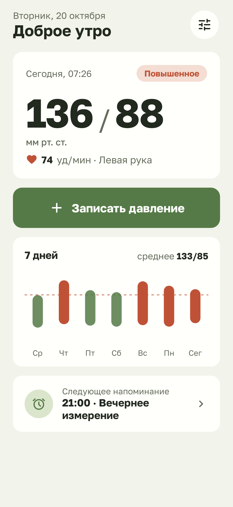
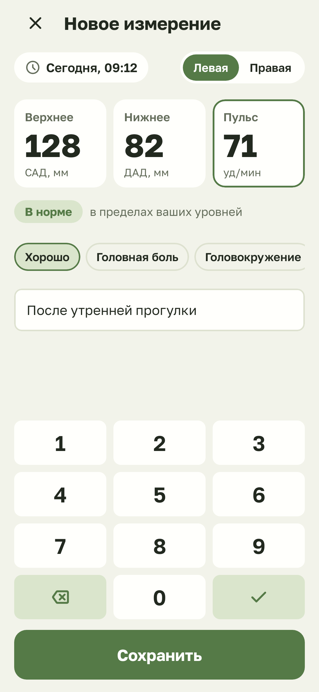
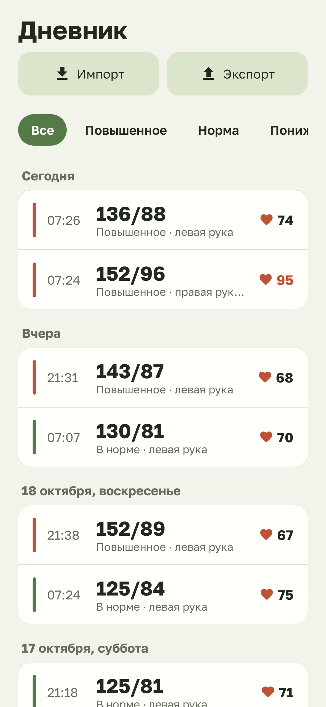
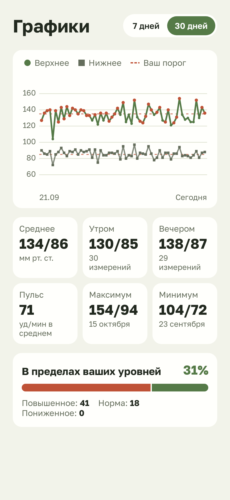
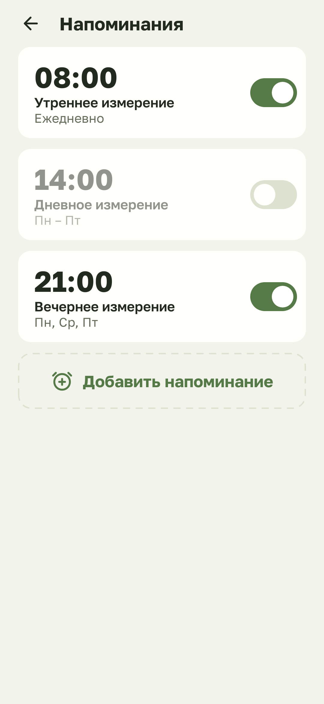
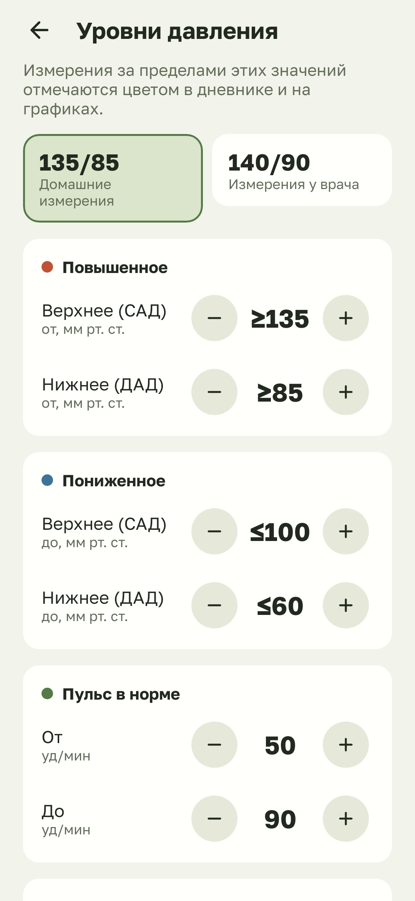
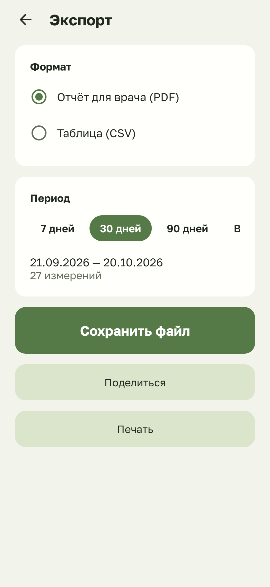
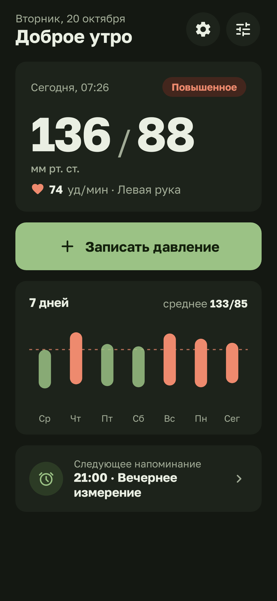

<div align="center">


# Дневник давления

**Спокойный помощник для тех, кто следит за давлением.**<br>
Записать измерение за 15 секунд, за один взгляд понять, как прошла неделя, и показать врачу внятную историю вместо бумажной тетради.


</div>

<table>
  <tr>
    <td align="center"><br><sub>Главная</sub></td>
    <td align="center"><br><sub>Ввод измерения</sub></td>
    <td align="center"><br><sub>Дневник</sub></td>
    <td align="center"><br><sub>Графики за 30 дней</sub></td>
  </tr>
  <tr>
    <td align="center"><br><sub>Напоминания</sub></td>
    <td align="center"><br><sub>Ваши уровни</sub></td>
    <td align="center"><br><sub>Отчёт для врача</sub></td>
    <td align="center"><br><sub>Тёмная тема</sub></td>
  </tr>
</table>

> Снимки экранов — это эталоны скриншот-тестов (Roborazzi) из `*/src/test/snapshots`: они всегда соответствуют текущему коду.

## Возможности

| | |
|---|---|
| ✍️ **Быстрый ввод** | Крупная цифровая клавиатура, автопереход между полями, верхнее давление до 300. Рука, самочувствие, комментарий. Дату и время можно поменять, если измерение забыли записать сразу |
| 🎨 **Статус цветом и словом** | «В норме», «Повышенное», «Пониженное» по уровням, которые вы согласовали с врачом. Есть готовые пресеты |
| 📖 **Дневник** | Записи по дням, фильтр по статусу, правка и удаление с «Отменить» |
| 📈 **Графики и статистика** | 7 и 30 дней: среднее, утро и вечер, пульс, максимум и минимум, доля измерений в пределах ваших уровней |
| ⏰ **Напоминания** | По времени и дням недели, «Отложить на 15 минут». Переживают перезагрузку и режим сна телефона, расписание само чинится каждые 6 часов |
| 🩺 **Отчёт для врача** | PDF за выбранный период: график, статистика, таблица измерений. Сохранить, отправить или сразу распечатать |
| 📤 **Перенос данных** | Экспорт в CSV и импорт из CSV других дневников: кодировка, разделитель и формат даты распознаются сами, с предпросмотром и отчётом об ошибках |
| 👓 **Для слабого зрения** | Три размера текста поверх системного, тёмная тема, подписи для TalkBack и кнопки не меньше 48 dp: тесты проверяют это на каждом экране, снимки — при шрифте ×2 |

## Приватность

- **Без интернета.** В манифесте нет разрешения `INTERNET`, и это проверяется задачей сборки `verifyReleaseManifest`.
- **Без аккаунта, рекламы и аналитики.** Сторонних SDK во время работы нет.
- **Данные только на телефоне.** Облачная резервная копия выключена. На новый телефон данные переносятся при прямой передаче устройство–устройство или через экспорт, который пользователь делает сам.
- **«Удалить все данные»** стирает записи, напоминания и настройки без возможности восстановления.

> [!IMPORTANT]
> Приложение не ставит диагноз и не заменяет врача. Оно записывает измерения, сравнивает их с вашими уровнями и напоминает.

## Технологии

| Слой | Что используется |
|---|---|
| Язык и UI | Kotlin 2.4, Jetpack Compose, Material 3, шрифт Golos Text |
| Архитектура | Многомодульная Clean Architecture, MVVM, однонаправленный поток данных |
| DI и навигация | Hilt, типобезопасные маршруты Navigation Compose |
| Данные | Room (схемы в git, без разрушающих миграций), DataStore, Paging 3 |
| Фоновая работа | AlarmManager (точные будильники), WorkManager |
| Отчёты | `PdfDocument` и `PrintManager` из Android SDK, без сторонних библиотек |
| Тесты | JUnit 5 и JUnit 4, Robolectric, Compose UI Test, Roborazzi, Turbine, Macrobenchmark |
| Качество | ktlint, detekt, Android Lint (предупреждения считаются ошибками), Baseline Profile |

## Устройство проекта

```text
app/                  Application, NavHost, оболочка с нижней навигацией, Hilt-граф
core/
├── model/            доменные модели (чистый Kotlin)
├── common/           TimeProvider, демо-данные
├── designsystem/     токены, темы, типографика, иконки
└── ui/               общие компоненты: NumPad, StatusChip, Stepper, BpBanner…
domain/               вся бизнес-логика на чистом Kotlin: классификация, ввод, статистика,
                      графики, расписание напоминаний, CSV, модель отчёта для врача
data/
├── database/         Room: entity, DAO, схемы
├── datastore/        настройки и уровни
├── repository/       реализации репозиториев
└── reminders/        будильники, уведомления, воркеры
feature/
└── home  entry  diary  charts  levels  reminders  settings  onboarding  transfer
build-logic/          convention-плагины Gradle (bp.android.*, bp.jvm)
benchmark/            Macrobenchmark и генератор Baseline Profile (по флагу -Pbp.benchmark)
```

Зависимости направлены внутрь: `feature → domain ← data`. В `domain` и `core:model` нет Android, строк и вызовов `now()`: время приходит только через `TimeProvider`, поэтому логика покрыта быстрыми JVM-тестами.

## Сборка

Нужны **JDK 21** и Android SDK (compile/target SDK 37).

```bash
export JAVA_HOME=/path/to/jdk-21
export ANDROID_HOME=/path/to/Android/Sdk
./gradlew assembleDebug
```

Отладочная сборка ставится рядом с релизной: `ru.bpdiary.app.debug`.

<details>
<summary><b>Полная проверка перед коммитом</b></summary>

```bash
./gradlew assembleDebug ktlintCheck detekt lintDebug test testDebugUnitTest verifyRoborazziDebug verifyReleaseManifest
```

| Задача | Что проверяет |
|---|---|
| `test` | JVM-модули (`domain`, `core:model`, `core:common`) |
| `testDebugUnitTest` | Android-модули на Robolectric: ViewModel, экраны, доступность |
| `verifyRoborazziDebug` | Сравнение экранов с эталонными снимками |
| `verifyReleaseManifest` | Нет `INTERNET`, `USE_EXACT_ALARM`, foreground service и cleartext-трафика |

Снимки перезаписывает `./gradlew recordRoborazziDebug`; `verifyRoborazziDebug` запускается отдельным вызовом.<br>
Сквозные сценарии на эмуляторе или телефоне запускает `./gradlew :app:connectedDebugAndroidTest`.

</details>

<details>
<summary><b>Релизная сборка</b></summary>

Релиз минифицируется R8 и подписывается, если есть `keystore.properties` (образец в `keystore.properties.example`) или переменные `BP_STORE_FILE`, `BP_STORE_PASSWORD`, `BP_KEY_ALIAS`, `BP_KEY_PASSWORD`. Без них собирается неподписанный бандл.

```bash
BP_VERSION_CODE=61 BP_VERSION_NAME=1.1.0 ./gradlew bundleRelease
```

Пошаговый список перед публикацией: [docs/release-checklist.md](docs/release-checklist.md).

</details>

## Документация

Проектная документация на русском лежит в [`docs/`](docs). Если документы расходятся, приоритет у реестра решений [12.7](docs/12-roadmap-backlog.md#127-реестр-решений).

| # | Документ | О чём |
|---|---|---|
| 01 | [Требования](docs/01-requirements.md) | Границы продукта, user stories, функциональные и нефункциональные требования |
| 02 | [Архитектура](docs/02-architecture.md) | Слои, модули, навигация, DI, потоки данных |
| 03 | [Модель данных](docs/03-data-model.md) | Room-схема, DataStore, миграции, запросы |
| 04 | [Дизайн-система](docs/04-design-system.md) | Токены, темы, типографика, компоненты |
| 05 | [Экраны](docs/05-screens.md) | Состояния, события и краевые случаи каждого экрана |
| 06 | [Бизнес-логика](docs/06-business-logic.md) | Классификация, статистика, графики, ввод с клавиатуры |
| 07 | [Напоминания](docs/07-reminders.md) | AlarmManager, разрешения, перезагрузка, Doze |
| 08 | [Экспорт и отчёт](docs/08-export-backup.md) | PDF для врача, CSV, резервная копия |
| 09 | [Приватность](docs/09-privacy-security.md) | Данные о здоровье, Play Data Safety, дисклеймеры |
| 10 | [Тестирование](docs/10-testing.md) | Пирамида тестов, обязательное покрытие, доступность |
| 11 | [Сборка и релиз](docs/11-build-release.md) | Gradle, подпись, CI, листинг в Play |
| 12 | [Роадмап](docs/12-roadmap-backlog.md) | MVP → v1.1 → v2, реестр решений |
| 13 | [CSV](docs/13-csv.md) | Импорт чужих форматов, канонический экспорт, образцы |

Ещё: [план реализации](IMPLEMENTATION_PLAN.md), [план доработок после ревизии кода](ROADMAP.md), [дизайн-хендофф](design_handoff_bp_diary/README.md), [чек-лист ручной проверки](docs/qa-checklist.md), [замеры производительности](docs/benchmarks.md).

## Статус

**1.1.0-rc4** — релиз-кандидат, в Google Play пока не опубликован.

- [x] MVP: ввод, дневник, графики, напоминания, уровни, онбординг, настройки
- [x] Версия 1.1: импорт и экспорт CSV, PDF для врача с печатью, дата и время измерения, размер текста
- [x] Ревизия кода 2026-11-14: этапы A (ошибки) и B (надёжность напоминаний) закрыты
- [ ] Подпись релиза, политика конфиденциальности, экран «Лицензии»
- [ ] Проверка на настоящих телефонах и закрытое тестирование в Play
